# Tuning results

Geomean speedup over `baseline`; other columns are means over traces. Differences under 0.1% are ties and keep the default.

## t1_st (task1)

Signature table size. The ST misses on 54% of demand loads at 64 entries, so the prefetcher never trains for most IPs; this is the most likely win. 256 is the cap (8-bit LRU).

| variant | knobs | speedup | coverage | L2C instr MPKI | L2C data MPKI |
|---|---|---|---|---|---|
| **st256** | SPP_ST_ENTRIES=256 | 1.0130 | 10.312 | 10.163 | 5.500 |
| st128 | SPP_ST_ENTRIES=128 | 1.0112 | 9.796 | 10.169 | 5.559 |
| default (spp) | (defaults) | 1.0079 | 8.699 | 10.195 | 5.651 |
| st32 | SPP_ST_ENTRIES=32 | 1.0052 | 6.320 | 10.169 | 5.742 |

Winner: `st256` (SPP_ST_ENTRIES=256)

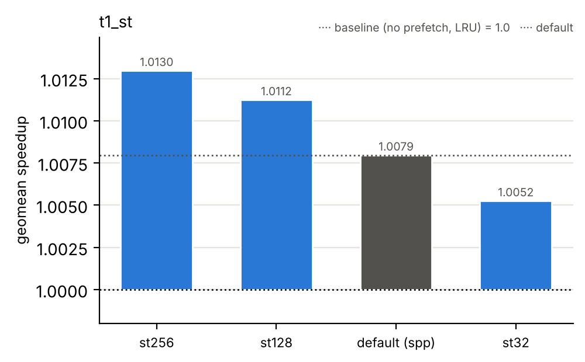

## t1_deg (task1)

Degree per accuracy range (deliverable). 'fixed3' turns throttling off (degree 3 everywhere, like ip_stride) to show what throttling buys; 'aggr' and 'cons' move the whole table up and down.

| variant | knobs | speedup | l1d_pf_accuracy | L2C instr MPKI | L2C data MPKI |
|---|---|---|---|---|---|
| fixed3 | SPP_DEGREE_HIGH=3, SPP_DEGREE_MID=3, SPP_DEGREE_LOW=3, SPP_DEGREE_POOR=3, SPP_DEGREE_TOXIC=3 | 1.0080 | 45.034 | 10.166 | 5.659 |
| default (spp) | (defaults) | 1.0079 | 45.413 | 10.195 | 5.651 |
| aggr | SPP_DEGREE_HIGH=6, SPP_DEGREE_MID=4, SPP_DEGREE_LOW=3, SPP_DEGREE_POOR=1, SPP_DEGREE_TOXIC=0 | 1.0079 | 42.641 | 10.196 | 5.630 |
| cons | SPP_DEGREE_HIGH=3, SPP_DEGREE_MID=2, SPP_DEGREE_LOW=1, SPP_DEGREE_POOR=1, SPP_DEGREE_TOXIC=0 | 1.0079 | 48.014 | 10.167 | 5.675 |

Winner: keep the default (no variant beats it by more than the noise margin)

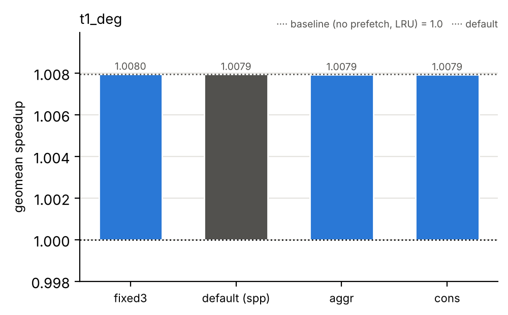

## t1_acc (task1)

Accuracy thresholds (deliverable). Filter accuracy sits at 67-70%, i.e. inside the MID band; 'strict' and 'loose' shift every boundary by about 0.1 so the measured accuracy lands in a different band.

| variant | knobs | speedup | l1d_pf_accuracy | L2C instr MPKI | L2C data MPKI |
|---|---|---|---|---|---|
| loose | SPP_ACC_HIGH=0.65, SPP_ACC_MID=0.4, SPP_ACC_LOW=0.2, SPP_ACC_TOXIC=0.05 | 1.0081 | 44.464 | 10.178 | 5.644 |
| default (spp) | (defaults) | 1.0079 | 45.413 | 10.195 | 5.651 |
| strict | SPP_ACC_HIGH=0.85, SPP_ACC_MID=0.65, SPP_ACC_LOW=0.35, SPP_ACC_TOXIC=0.15 | 1.0079 | 46.798 | 10.177 | 5.663 |

Winner: keep the default (no variant beats it by more than the noise margin)

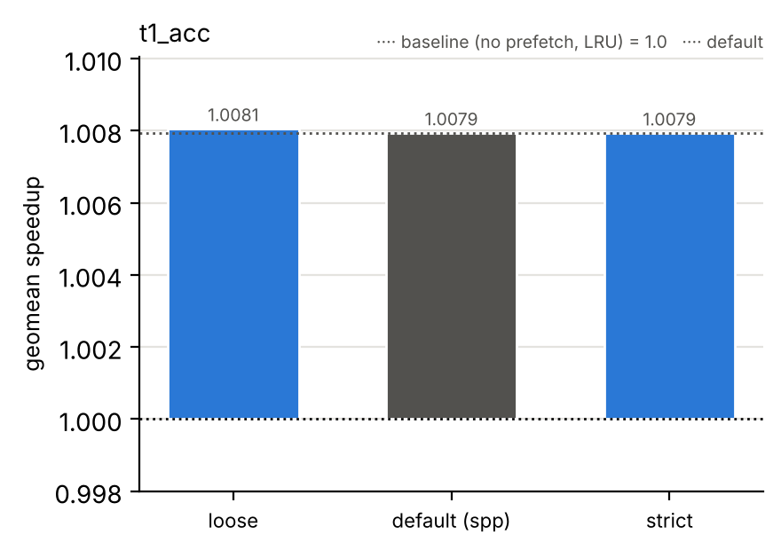

## t1_pt (task1)

Pattern-table confidence. 72% of SPP prefetches come from the pattern table, so its thresholds set most of the accuracy/coverage trade-off.

| variant | knobs | speedup | l1d_pf_accuracy | L2C instr MPKI | L2C data MPKI |
|---|---|---|---|---|---|
| conf1 | SPP_PT_CONF_THRESHOLD=1, SPP_PT_LOOKAHEAD_CONF=1 | 1.0085 | 40.711 | 10.244 | 5.547 |
| default (spp) | (defaults) | 1.0079 | 45.413 | 10.195 | 5.651 |
| look3 | SPP_PT_LOOKAHEAD_CONF=3 | 1.0079 | 46.314 | 10.157 | 5.670 |
| conf3 | SPP_PT_CONF_THRESHOLD=3, SPP_PT_LOOKAHEAD_CONF=3 | 1.0072 | 47.972 | 10.134 | 5.740 |

Winner: keep the default (no variant beats it by more than the noise margin)

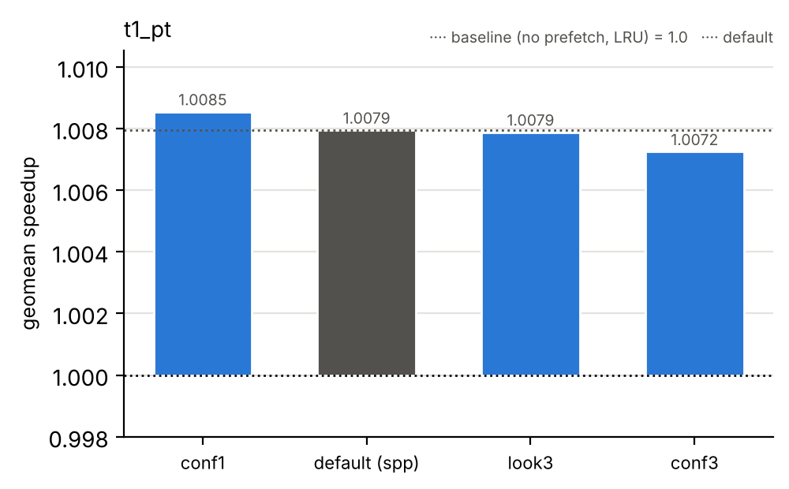

## t1_sig (task1)

Signature length / PT size: 8 bits = 256-entry PT (saves 6.9 Kbit), 12 bits = 4096 entries, shift 2 keeps ~5 strides of history instead of ~3.

| variant | knobs | speedup | coverage | L2C instr MPKI | L2C data MPKI |
|---|---|---|---|---|---|
| sig12 | SPP_SIG_BITS=12 | 1.0081 | 9.030 | 10.188 | 5.635 |
| default (spp) | (defaults) | 1.0079 | 8.699 | 10.195 | 5.651 |
| sig8 | SPP_SIG_BITS=8 | 1.0079 | 8.432 | 10.172 | 5.658 |
| shift2 | SPP_SIG_SHIFT=2 | 1.0075 | 8.154 | 10.180 | 5.684 |

Winner: keep the default (no variant beats it by more than the noise margin)

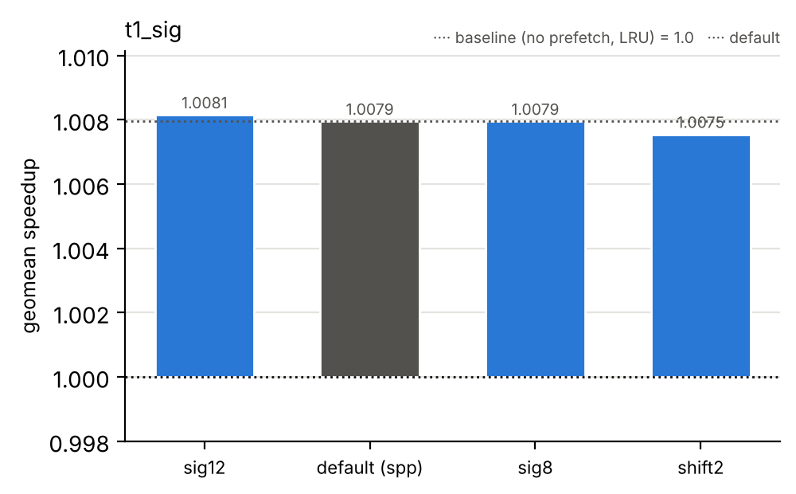

## t1_fsm (task1)

Uniform-stride FSM: confidence needed before uniform prefetching, and the hysteresis to return from NON_UNIFORM to UNIFORM.

| variant | knobs | speedup | l1d_pf_accuracy | L2C instr MPKI | L2C data MPKI |
|---|---|---|---|---|---|
| reentry2 | SPP_UNIFORM_REENTRY=2 | 1.0081 | 45.500 | 10.195 | 5.642 |
| default (spp) | (defaults) | 1.0079 | 45.413 | 10.195 | 5.651 |
| uconf2 | SPP_UCONF_THRESHOLD=2 | 1.0076 | 45.457 | 10.186 | 5.668 |

Winner: keep the default (no variant beats it by more than the noise margin)

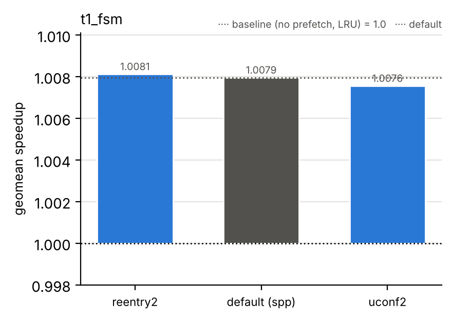

## t1_epoch (task1)

Throttling epoch length: faster reaction vs. noisier accuracy estimates.

| variant | knobs | speedup | l1d_pf_accuracy | L2C instr MPKI | L2C data MPKI |
|---|---|---|---|---|---|
| ep256 | SPP_EPOCH_ACCESSES=256 | 1.0082 | 45.407 | 10.167 | 5.651 |
| ep4096 | SPP_EPOCH_ACCESSES=4096 | 1.0081 | 45.559 | 10.168 | 5.649 |
| default (spp) | (defaults) | 1.0079 | 45.413 | 10.195 | 5.651 |

Winner: keep the default (no variant beats it by more than the noise margin)

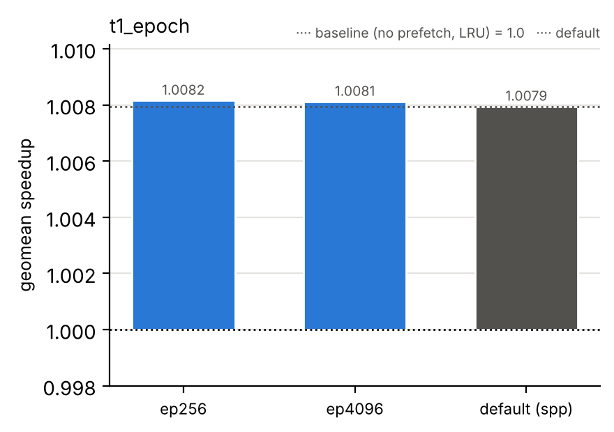

## t1_filter (task1)

Prefetch-filter reach (accuracy checker + duplicate filter): 128 vs 512 entries.

| variant | knobs | speedup | l1d_pf_accuracy | L2C instr MPKI | L2C data MPKI |
|---|---|---|---|---|---|
| default (spp) | (defaults) | 1.0079 | 45.413 | 10.195 | 5.651 |
| f512 | SPP_FILTER_INDEX_BITS=9 | 1.0079 | 45.782 | 10.175 | 5.651 |
| f128 | SPP_FILTER_INDEX_BITS=7 | 1.0079 | 45.593 | 10.209 | 5.652 |

Winner: keep the default (no variant beats it by more than the noise margin)

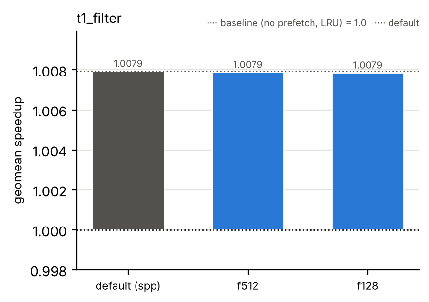

## t2a_insert (task2a)

Insertion: instructions at 0 (stronger priority) and data at maxRRPV (data as eviction candidates).

| variant | knobs | speedup | l2c_load_mpki | L2C instr MPKI | L2C data MPKI |
|---|---|---|---|---|---|
| **data3** | IRRIP_INSERT_DATA=3 | 1.0100 | 14.169 | 6.742 | 7.427 |
| default (irrip) | (defaults) | 1.0081 | 14.289 | 7.665 | 6.624 |
| instr0 | IRRIP_INSERT_INSTR=0 | 1.0075 | 14.513 | 7.756 | 6.757 |

Winner: `data3` (IRRIP_INSERT_DATA=3)

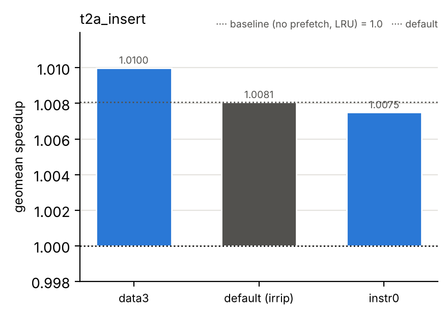

## t2a_promo (task2a)

Promotion: SRRIP-style data hit -> 0 vs. the default one-step promotion, and a two-step promotion.

| variant | knobs | speedup | l2c_load_mpki | L2C instr MPKI | L2C data MPKI |
|---|---|---|---|---|---|
| default (irrip) | (defaults) | 1.0081 | 14.289 | 7.665 | 6.624 |
| hp | IRRIP_DATA_HIT_MODE=0 | 1.0075 | 14.398 | 7.915 | 6.483 |
| step2 | IRRIP_DATA_HIT_STEP=2 | 1.0074 | 14.389 | 7.881 | 6.508 |

Winner: keep the default (no variant beats it by more than the noise margin)

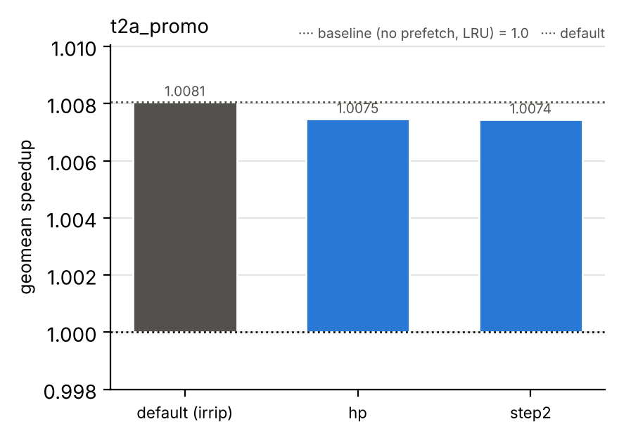

## t2a_evict (task2a)

Eviction: plain SRRIP victim choice (shows what the tie-break buys) vs. the stronger mode 2.

| variant | knobs | speedup | l2c_load_mpki | L2C instr MPKI | L2C data MPKI |
|---|---|---|---|---|---|
| **strong** | IRRIP_EVICT_MODE=2 | 1.0133 | 14.135 | 6.317 | 7.817 |
| default (irrip) | (defaults) | 1.0081 | 14.289 | 7.665 | 6.624 |
| plain | IRRIP_EVICT_MODE=0 | 1.0062 | 14.675 | 8.205 | 6.471 |

Winner: `strong` (IRRIP_EVICT_MODE=2)

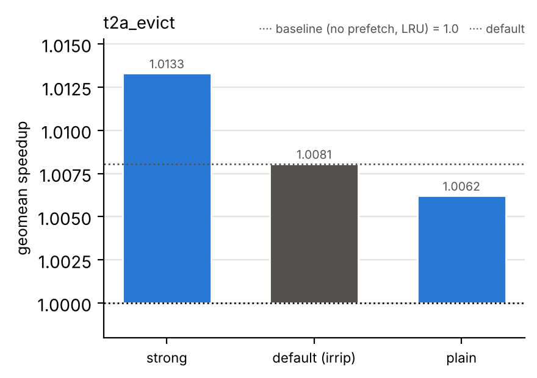

## t2b_thr (task2b)

5-point threshold sensitivity (deliverable), re-centred on the measured ratio range 0.27-0.60. Default decision mode (ratio AND duel guard).

| variant | knobs | speedup | l2c_load_mpki | L2C instr MPKI | L2C data MPKI |
|---|---|---|---|---|---|
| default (dyn_irrip) | (defaults) | 1.0062 | 14.525 | 8.296 | 6.229 |
| t030 | DIRRIP_THRESHOLD=0.3 | 1.0062 | 14.525 | 8.296 | 6.229 |
| t040 | DIRRIP_THRESHOLD=0.4 | 1.0059 | 14.566 | 8.357 | 6.209 |
| t050 | DIRRIP_THRESHOLD=0.5 | 1.0059 | 14.564 | 8.424 | 6.140 |
| t060 | DIRRIP_THRESHOLD=0.6 | 1.0053 | 14.669 | 8.555 | 6.115 |
| t070 | DIRRIP_THRESHOLD=0.7 | 1.0040 | 14.937 | 8.934 | 6.002 |

Winner: keep the default (no variant beats it by more than the noise margin)

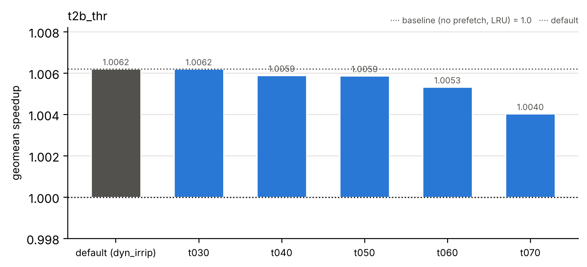

## t2b_thr_ratio (task2b)

Same 5 thresholds with the ratio alone (exactly the spec's formula), isolating the threshold's effect from the duel guard.

| variant | knobs | speedup | l2c_load_mpki | L2C instr MPKI | L2C data MPKI |
|---|---|---|---|---|---|
| **t040** | DIRRIP_DECISION_MODE=0, DIRRIP_THRESHOLD=0.4 | 1.0077 | 14.362 | 7.824 | 6.538 |
| t050 | DIRRIP_DECISION_MODE=0, DIRRIP_THRESHOLD=0.5 | 1.0076 | 14.370 | 7.982 | 6.388 |
| t030 | DIRRIP_DECISION_MODE=0, DIRRIP_THRESHOLD=0.3 | 1.0075 | 14.389 | 7.782 | 6.606 |
| t060 | DIRRIP_DECISION_MODE=0, DIRRIP_THRESHOLD=0.6 | 1.0068 | 14.493 | 8.187 | 6.306 |
| default (dyn_irrip) | (defaults) | 1.0062 | 14.525 | 8.296 | 6.229 |
| t070 | DIRRIP_DECISION_MODE=0, DIRRIP_THRESHOLD=0.7 | 1.0040 | 14.937 | 8.934 | 6.002 |

Winner: `t040` (DIRRIP_DECISION_MODE=0, DIRRIP_THRESHOLD=0.4)

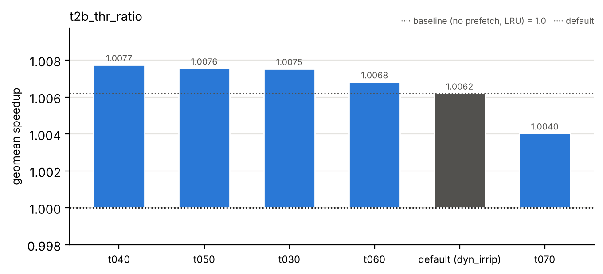

## t2b_mode (task2b)

Decision logic: ratio only vs. classic duel only vs. both (default).

| variant | knobs | speedup | l2c_load_mpki | L2C instr MPKI | L2C data MPKI |
|---|---|---|---|---|---|
| **ratio** | DIRRIP_DECISION_MODE=0 | 1.0075 | 14.389 | 7.782 | 6.607 |
| duel | DIRRIP_DECISION_MODE=1 | 1.0063 | 14.468 | 8.222 | 6.246 |
| default (dyn_irrip) | (defaults) | 1.0062 | 14.525 | 8.296 | 6.229 |

Winner: `ratio` (DIRRIP_DECISION_MODE=0)

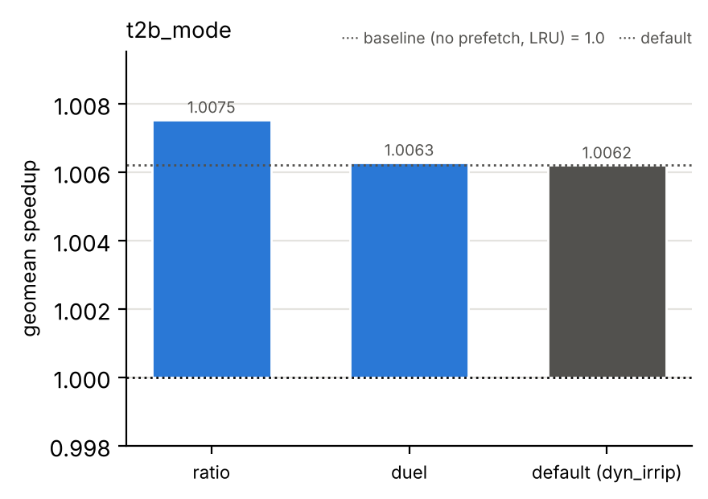

## t2b_leaders (task2b)

Leader sets per policy (deliverable): 16 = less sampling, fewer sets stuck on the wrong policy; 64 = better estimates, 12.5% of the cache fixed.

| variant | knobs | speedup | l2c_load_mpki | L2C instr MPKI | L2C data MPKI |
|---|---|---|---|---|---|
| **l16** | DIRRIP_LEADER_SETS=16 | 1.0076 | 14.354 | 7.867 | 6.488 |
| l64 | DIRRIP_LEADER_SETS=64 | 1.0066 | 14.498 | 8.083 | 6.415 |
| default (dyn_irrip) | (defaults) | 1.0062 | 14.525 | 8.296 | 6.229 |

Winner: `l16` (DIRRIP_LEADER_SETS=16)

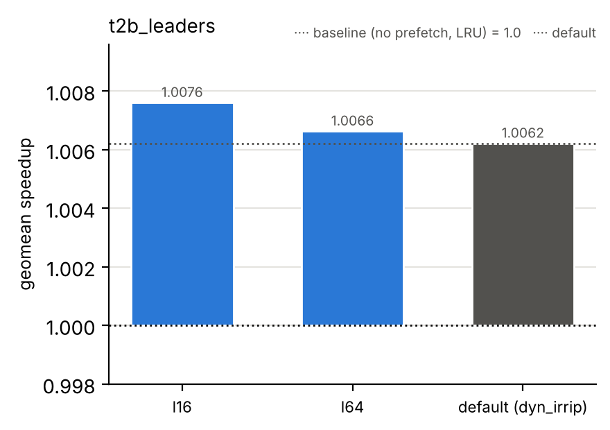

## t2b_epoch (task2b)

Decision epoch: 4K accesses (fast, noisy; switches are already frequent at 16K) vs 64K (stable).

| variant | knobs | speedup | l2c_load_mpki | L2C instr MPKI | L2C data MPKI |
|---|---|---|---|---|---|
| e4k | DIRRIP_EPOCH_ACCESSES=4096 | 1.0066 | 14.474 | 8.227 | 6.247 |
| default (dyn_irrip) | (defaults) | 1.0062 | 14.525 | 8.296 | 6.229 |
| e64k | DIRRIP_EPOCH_ACCESSES=65536 | 1.0055 | 14.647 | 8.480 | 6.167 |

Winner: keep the default (no variant beats it by more than the noise margin)

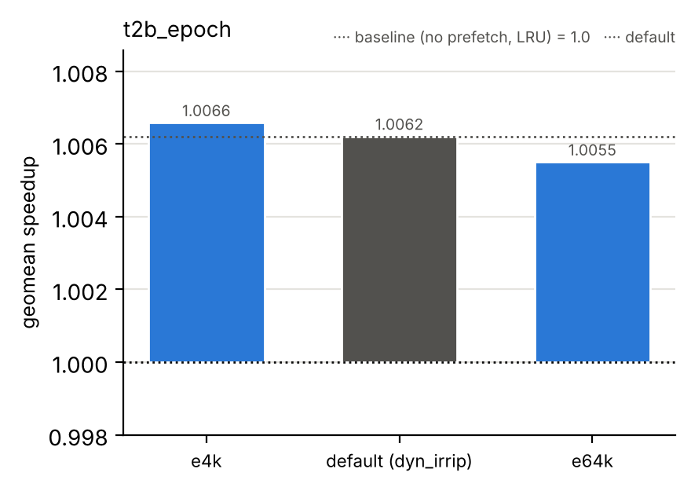

## t2b_cost (task2b)

Instruction-miss cost c in the duel guard. Static I-RRIP beats dynamic, so the guard falls back to SRRIP too often (69% of epochs on Trace2). Over the whole run on Trace2 the I-RRIP leaders saved 350 instruction misses and added 2,655 data misses against the SRRIP leaders, so the guard only prefers I-RRIP when c > 7.6; c4 and c8 bracket that break-even point, c1 shows the opposite end.

| variant | knobs | speedup | l2c_load_mpki | L2C instr MPKI | L2C data MPKI |
|---|---|---|---|---|---|
| c4 | DIRRIP_INSTR_MISS_COST=4.0 | 1.0065 | 14.498 | 8.147 | 6.352 |
| c8 | DIRRIP_INSTR_MISS_COST=8.0 | 1.0065 | 14.496 | 8.129 | 6.367 |
| default (dyn_irrip) | (defaults) | 1.0062 | 14.525 | 8.296 | 6.229 |
| c1 | DIRRIP_INSTR_MISS_COST=1.0 | 1.0055 | 14.635 | 8.508 | 6.128 |

Winner: keep the default (no variant beats it by more than the noise margin)

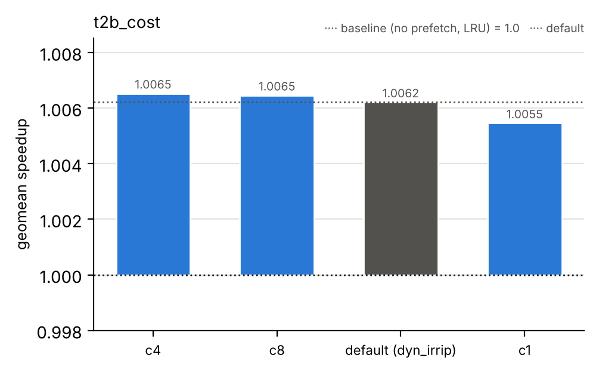

## t2b_hyst (task2b)

Hysteresis and guard margin: no band vs. a wide band plus a 5% guard margin (fewer switches).

| variant | knobs | speedup | l2c_load_mpki | L2C instr MPKI | L2C data MPKI |
|---|---|---|---|---|---|
| default (dyn_irrip) | (defaults) | 1.0062 | 14.525 | 8.296 | 6.229 |
| h0 | DIRRIP_HYSTERESIS=0.0 | 1.0062 | 14.525 | 8.296 | 6.229 |
| h15 | DIRRIP_HYSTERESIS=0.15, DIRRIP_GUARD_MARGIN=0.05 | 1.0060 | 14.556 | 8.207 | 6.349 |

Winner: keep the default (no variant beats it by more than the noise margin)

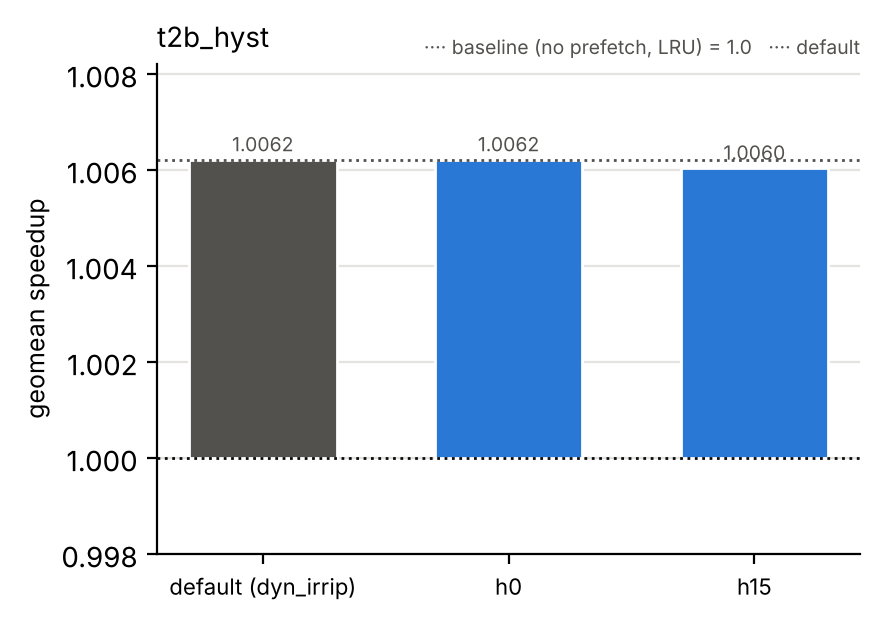

## t3_insert (task3)

Prefetch insertion position: far = maxRRPV-1 (same as demand data, i.e. no distant insertion), and everything far (L2-only prefetches too).

| variant | knobs | speedup | l2c_load_mpki | L2C instr MPKI | L2C data MPKI |
|---|---|---|---|---|---|
| default (spp_pf_dyn_irrip) | (defaults) | 1.0150 | 13.881 | 8.192 | 5.688 |
| far2 | DIRRIP_PF_INSERT_FAR=2 | 1.0147 | 13.942 | 8.261 | 5.681 |
| allfar | DIRRIP_PF_USE_FILL_LEVEL=0, DIRRIP_PF_ADAPTIVE=0 | 1.0146 | 13.948 | 8.274 | 5.674 |

Winner: keep the default (no variant beats it by more than the noise margin)

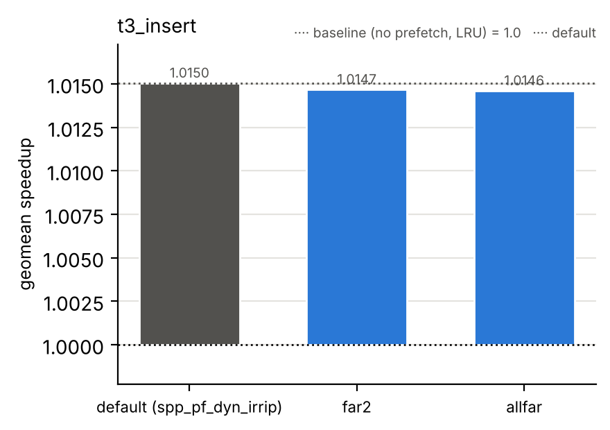

## t3_ablate (task3)

Ablation of each prefetch-awareness mechanism (rationale deliverable): turning one off at a time shows what each contributes. spp_dyn_irrip already measures turning all of them off.

| variant | knobs | speedup | l2c_load_mpki | L2C instr MPKI | L2C data MPKI |
|---|---|---|---|---|---|
| default (spp_pf_dyn_irrip) | (defaults) | 1.0150 | 13.881 | 8.192 | 5.688 |
| noevict | DIRRIP_PF_EVICT_FIRST=0 | 1.0149 | 13.902 | 8.207 | 5.695 |
| hitpromote | DIRRIP_PF_HIT_PROMOTE=1 | 1.0149 | 13.911 | 8.231 | 5.681 |
| nofirstuse | DIRRIP_PF_FIRST_USE_AS_INSERT=0 | 1.0146 | 13.959 | 8.278 | 5.681 |

Winner: keep the default (no variant beats it by more than the noise margin)

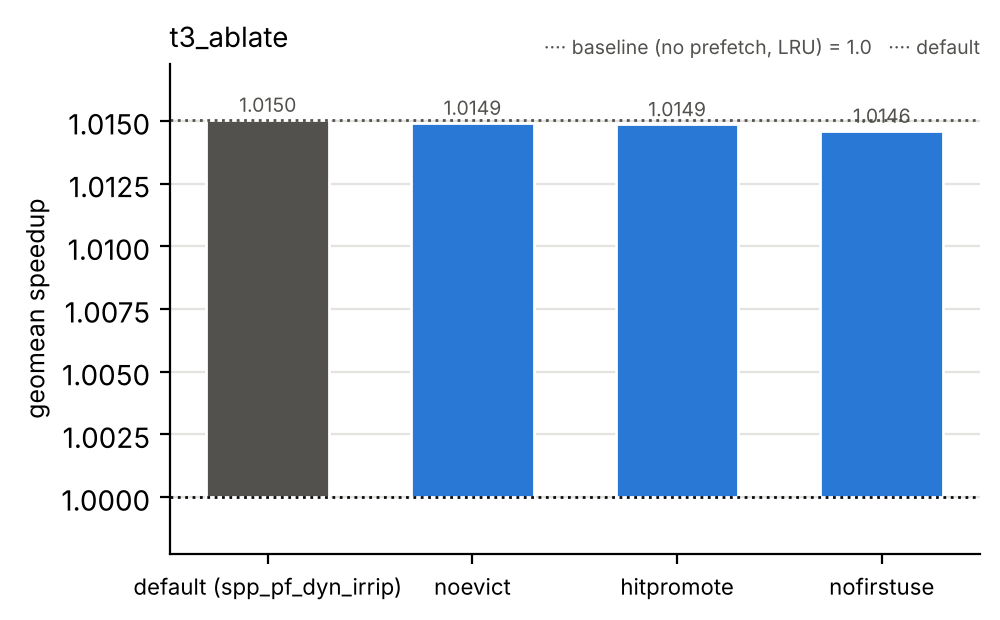

## t3_reuse (task3)

Reuse threshold for near insertion. Measured L2 prefetch reuse is ~3%, so 0.5 never fires; only thresholds below 0.1 can change anything.

| variant | knobs | speedup | l2c_load_mpki | L2C instr MPKI | L2C data MPKI |
|---|---|---|---|---|---|
| default (spp_pf_dyn_irrip) | (defaults) | 1.0150 | 13.881 | 8.192 | 5.688 |
| r008 | DIRRIP_PF_REUSE_HIGH=0.08 | 1.0150 | 13.899 | 8.214 | 5.686 |
| r003 | DIRRIP_PF_REUSE_HIGH=0.03 | 1.0147 | 13.924 | 8.261 | 5.663 |

Winner: keep the default (no variant beats it by more than the noise margin)

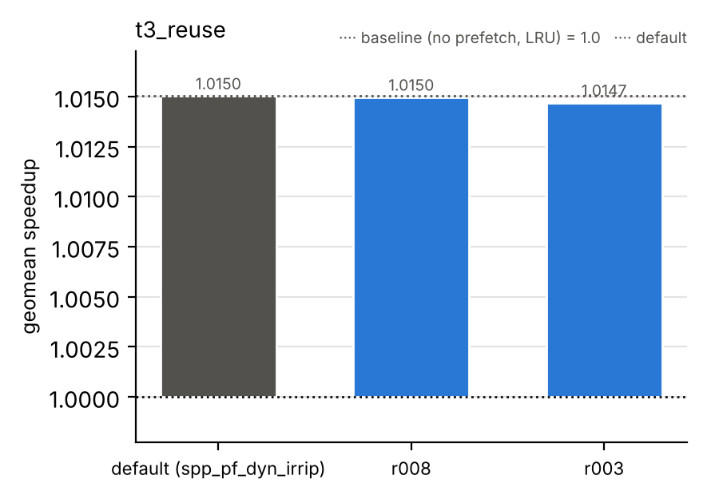

## t3_spp (task3)

Cross-task interaction: with L2 now absorbing useless prefetches at maxRRPV, a more aggressive SPP may pay off where it did not with LRU.

| variant | knobs | speedup | coverage | L2C instr MPKI | L2C data MPKI |
|---|---|---|---|---|---|
| aggr | SPP_DEGREE_HIGH=6, SPP_DEGREE_MID=4, SPP_DEGREE_LOW=3, SPP_DEGREE_POOR=1, SPP_DEGREE_TOXIC=0 | 1.0156 | 9.088 | 8.150 | 5.672 |
| default (spp_pf_dyn_irrip) | (defaults) | 1.0150 | 8.707 | 8.192 | 5.688 |

Winner: keep the default (no variant beats it by more than the noise margin)

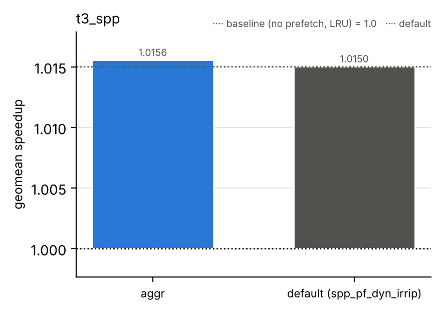

## task1_final (task1)

The per-experiment winners of task1 combined into one build.

| variant | knobs | speedup | coverage | L2C instr MPKI | L2C data MPKI |
|---|---|---|---|---|---|
| **best** | SPP_ST_ENTRIES=256 | 1.0130 | 10.312 | 10.163 | 5.500 |
| default (spp) | (defaults) | 1.0079 | 8.699 | 10.195 | 5.651 |

Winner: `best` (SPP_ST_ENTRIES=256)

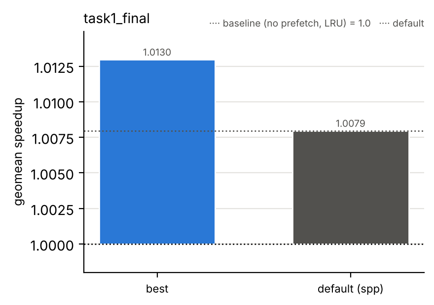

## task2a_final (task2a)

The per-experiment winners of task2a combined into one build.

| variant | knobs | speedup | l2c_load_mpki | L2C instr MPKI | L2C data MPKI |
|---|---|---|---|---|---|
| **best** | IRRIP_INSERT_DATA=3, IRRIP_EVICT_MODE=2 | 1.0135 | 14.350 | 6.203 | 8.148 |
| default (irrip) | (defaults) | 1.0081 | 14.289 | 7.665 | 6.624 |

Winner: `best` (IRRIP_INSERT_DATA=3, IRRIP_EVICT_MODE=2)

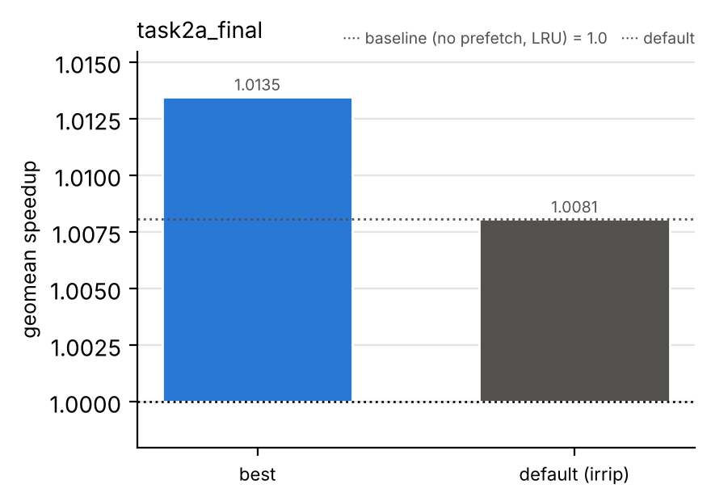

## task2b_final (task2b)

The per-experiment winners of task2b combined into one build.

| variant | knobs | speedup | l2c_load_mpki | L2C instr MPKI | L2C data MPKI |
|---|---|---|---|---|---|
| **best** | DIRRIP_DECISION_MODE=0, DIRRIP_LEADER_SETS=16, DIRRIP_THRESHOLD=0.4 | 1.0077 | 14.377 | 7.819 | 6.558 |
| default (dyn_irrip) | (defaults) | 1.0062 | 14.525 | 8.296 | 6.229 |

Winner: `best` (DIRRIP_DECISION_MODE=0, DIRRIP_LEADER_SETS=16, DIRRIP_THRESHOLD=0.4)

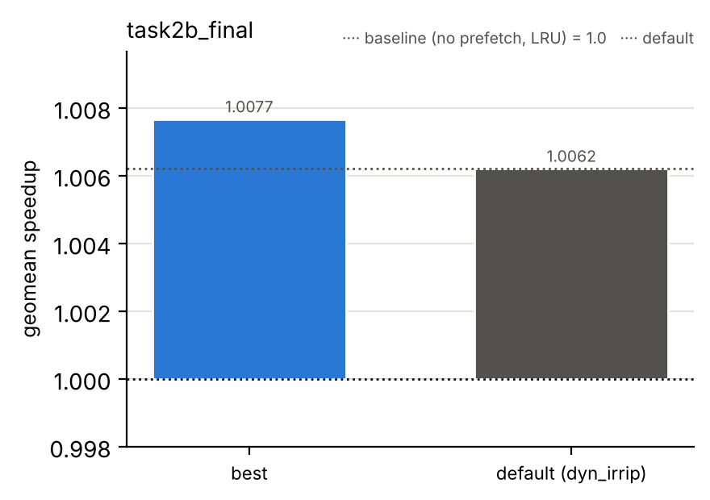
